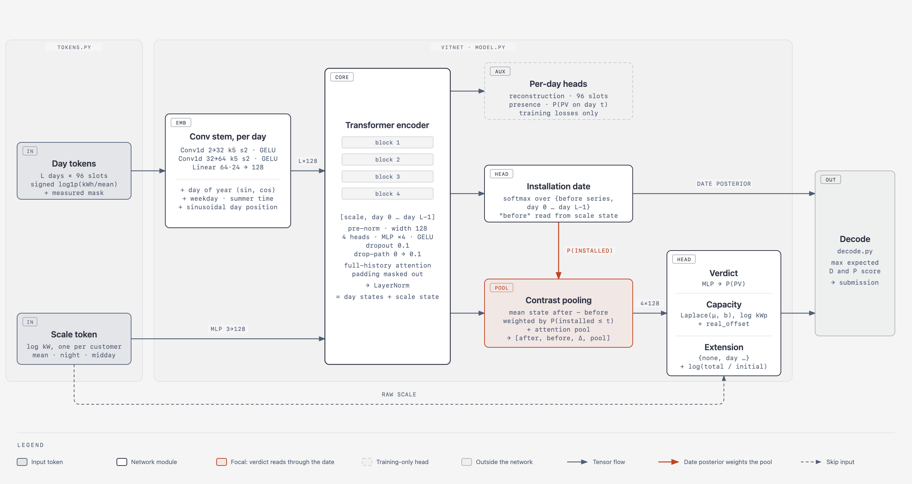

# The ViT architecture, explained

This is a study guide to the network in [`vit-architecture.png`](vit-architecture.png). It walks through the diagram from
left to right and explains:

- what each box computes;
- what shape each tensor has;
- why each part was built that way;
- the machine-learning ideas behind it, in plain words.

The code is [`src/pvdetect/vit/model.py`](../../src/pvdetect/vit/model.py) (class `VitNet`), with inputs from
[`tokens.py`](../../src/pvdetect/vit/tokens.py) and outputs decoded by [`decode.py`](../../src/pvdetect/vit/decode.py)
and [`predictor.py`](../../src/pvdetect/vit/predictor.py). For training, results and how to run it, see
[`docs/vit.md`](../vit.md). For the design research with sources, see
[`docs/research/vit-multitask.md`](../research/vit-multitask.md).



## Contents

1. [The problem in one paragraph](#1-the-problem-in-one-paragraph)
2. [The big picture](#2-the-big-picture)
3. [Inputs: day tokens and the scale token](#3-inputs-day-tokens-and-the-scale-token)
4. [The conv stem: from 96 numbers to one vector per day](#4-the-conv-stem-from-96-numbers-to-one-vector-per-day)
5. [Calendar and position: telling the model *when* a day is](#5-calendar-and-position-telling-the-model-when-a-day-is)
6. [The transformer encoder](#6-the-transformer-encoder)
7. [The per-day heads (training only)](#7-the-per-day-heads-training-only)
8. [The installation-date head](#8-the-installation-date-head)
9. [Contrast pooling: the key idea](#9-contrast-pooling-the-key-idea)
10. [The task heads: verdict, capacity, extension](#10-the-task-heads-verdict-capacity-extension)
11. [The losses: how every box learns](#11-the-losses-how-every-box-learns)
12. [Decode: from distributions to submitted answers](#12-decode-from-distributions-to-submitted-answers)
13. [Where the 1.3 M parameters are](#13-where-the-13-m-parameters-are)
14. [What the diagram simplifies](#14-what-the-diagram-simplifies)
15. [Glossary](#15-glossary)
16. [Check your understanding](#16-check-your-understanding)

---

## 1. The problem in one paragraph

For each customer we have years of electricity **withdrawal** from the grid: one number (kWh) per quarter-hour, so
96 numbers per day. The challenge asks four things:

1. Does this customer have solar panels (PV)?
2. If so, from which day?
3. How big was the installation (initial capacity, in kWp)?
4. Was it extended later, when, and to what total size?

We never see the solar production. We only see its **footprint**: from some day on, midday withdrawal drops
because the panels cover part of the household's own use. The network has to find that lasting change in a long,
noisy series, date it, and judge its size.

## 2. The big picture

The diagram reads left to right in four stages:

| Stage | Boxes | What happens |
| --- | --- | --- |
| Tokenise | Day tokens, Scale token | Turn the raw series into model inputs: one token per day and one per customer. |
| Embed | Conv stem (+ calendar, position) | Turn each day's 96 numbers into one 128-number vector that also says *when* the day is. |
| Contextualise | Transformer encoder | Let every day look at every other day across the whole history, so each day's vector "knows" its context. |
| Read out | Per-day heads, date head, contrast pooling, task heads, decode | Turn the day vectors into answers for each challenge question. |

Two ideas make this model more than a generic transformer:

- **One token per day.** A day is the natural unit: the sun's pattern repeats daily, and the date answer is scored
  in days.
- **The verdict reads through the date.** The network first predicts *when* PV appeared. It then compares the
  days after that date with the days before it, and judges *whether* there is PV and *how big* it is from that
  contrast. This is the orange part of the diagram.

### Notation

| Symbol | Meaning | Typical value |
| --- | --- | --- |
| `B` | batch size (customers processed together) | 16 in training, 1 at prediction |
| `L` | number of days in the history (or the crop) | 365 to 1,462 |
| `T = L + 1` | sequence length: the scale token plus L day tokens | up to 1,463 |
| `d` | model width (`d_model`) | 128 |
| `S` | slots per day | 96 |

## 3. Inputs: day tokens and the scale token

Code: `tokens()` in [`tokens.py`](../../src/pvdetect/vit/tokens.py). Input: the converter's `DayMatrix`, a
`days × 96` matrix of kWh per **UTC** quarter-hour plus a boolean mask of which slots were actually measured
([ADR 0001](../adr/0001-utc-day-matrix.md)).

### Why UTC days?

In UTC the sun is in the same slots all year. Solar noon in Switzerland is near 11:30 UTC in both winter and
summer. In local time it would jump by an hour at each clock change. A UTC day matrix keeps the solar signal in
fixed columns, which is what lets a convolution or a linear layer learn "the midday slots".

### Day tokens: values plus mask

For each day the model gets two rows of 96 numbers:

- **values:** `sign(r) · log(1 + |r|)`, where `r = kWh / mean kWh of this customer`. Unmeasured slots are set to 0.
- **mask:** 1 where the slot was measured, 0 where it is missing.

Why each step:

- **Divide by the customer's own mean.** A villa and a flat then look alike. The day tokens describe the *shape*
  of consumption, not its size, so one network serves customers of any size.
- **`log1p`.** It compresses spikes (an oven, a heat pump starting) so that a few huge values do not dominate. Near 0
  it behaves like the identity, so small values keep their detail. The sign makes it safe for negative values.
- **The mask as a separate channel.** A 0 could mean "no consumption" or "no data". The mask tells the network
  which it is. In the stem's input the value channel is `values × mask`, so missing slots are exactly 0.

Shape: `values` and `mask` are `(B, L, 96)`.

### The scale token

Dividing by the mean throws away absolute size, but capacity (kWp) is an absolute number. A 10 kWp plant on a
small house and on a large one leave footprints of different *relative* depth. So size comes back through one
extra token per customer that holds three numbers, all in log kW:

| Feature | Slots used | What it tells the model |
| --- | --- | --- |
| `log(4 · mean kWh + 0.01)` | all measured | average power draw |
| night median | 20:00–03:30 UTC (always dark) | base load, which PV cannot touch |
| midday median | 09:00–14:00 UTC (always sunlit) | daytime load, which PV reduces |

The `4 ·` turns kWh per quarter-hour into kW. The `+ 0.01` floor keeps the log finite for a customer at zero.

A useful intuition: the gap between the night and midday levels hints at how much PV is eating into daytime
withdrawal.

Shape: `scale` is `(B, 3)`. Inside the network a small MLP (3 → 128 → 128, GELU) turns it into a 128-number token,
the "MLP 3→128" label on the arrow.

## 4. The conv stem: from 96 numbers to one vector per day

Code: `VitNet.stem` and `VitNet.stem_out`. The stem runs on every day independently: it never mixes days. Each
day's `(2, 96)` input (value channel and mask channel) goes through:

| Layer | Output shape per day | What it does |
| --- | --- | --- |
| `Conv1d(2→32, kernel 5, stride 2, padding 2)` + GELU | `(32, 48)` | 32 learned detectors, each looking at 5 consecutive quarter-hours (75 minutes) |
| `Conv1d(32→64, kernel 5, stride 2, padding 2)` + GELU | `(64, 24)` | 64 detectors over the first layer's outputs, now seeing about 3 hours of the day |
| flatten + `Linear(64·24 = 1,536 → 128)` | `(128,)` | mix all positions and detectors into one day vector |

**What a 1-D convolution is:** a small window (here 5 slots wide) slides along the day. At each position it
computes a weighted sum of the values under it, with the same weights everywhere. It finds local patterns, such as
"a dip between 10:00 and 14:00" or "a sharp morning ramp", wherever they occur.

**What stride 2 does:** the window jumps 2 slots at a time, so each layer halves the length (96 → 48 → 24). This
compresses the day while widening what each output sees.

**GELU** is the nonlinearity (a smooth version of ReLU). Without nonlinearities, stacked layers would collapse into
one linear map.

**Why a conv stem rather than a plain linear projection?** The original ViT cuts an image into patches and
projects each with one linear layer. A conv stem gives each day's 96 slots local structure first: neighbouring
quarter-hours belong together. Studies on "early convolutions" in ViTs, and PatchTST on time series, report that
patches with local meaning train more stably and generalise better (see the research note).

**Why one token per day rather than per week?** The date is scored to the day, with full credit only at 0 days of
error and linearly less up to 30 days. A token per week could only place the date to the week, which was estimated
to cost about 0.06 of D.

Output: the day embeddings, shape `(B, L, 128)`.

## 5. Calendar and position: telling the model *when* a day is

A transformer does not know the order of its inputs. To it, the sequence is a set. Order and calendar have to be
**added** into each day vector. Four 128-number vectors are summed onto each day embedding:

| Added term | Code | Why the model needs it |
| --- | --- | --- |
| day of year as `(sin, cos)` → `Linear(2→128)` | `calendar` | Seasons: midday withdrawal drops naturally in summer (more light, no heating), and PV yield is seasonal. sin/cos makes 31 Dec and 1 Jan neighbours. |
| weekday → `Embedding(7, 128)` | `weekday` | Weekends change the daily routine. |
| Swiss summer time (CEST) flag → `Embedding(2, 128)` | `summer` | Human routines move by one hour (4 slots) in UTC at each clock change, but the sun does not. The flag lets the model tell a habit shift from a solar change. |
| sinusoidal position of the day in the sequence | `positions()` | Order and distance between days: needed to say "everything after day 412 changed". |

**What an embedding is:** a lookup table of learned vectors. `Embedding(7, 128)` holds 7 vectors of 128 numbers,
one per weekday, and the model learns them.

**Sinusoidal positions** are the formula from the original transformer paper: dimension pair `i` gets
`sin(pos / 10000^(2i/d))` and `cos(…)`. They are not learned, so the model accepts any history length, with no
fixed maximum. That matters because customers have 1 to 4 years of data.

**Why add rather than concatenate?** It is the standard transformer practice. In 128 dimensions the network learns
to keep these signals in directions that do not get in each other's way, and the width stays 128.

The **scale token** is prepended at position 0 and gets no calendar or position terms: it is not a day.

The sequence entering the encoder is `[scale token, day 0, day 1, …, day L−1]`, shape `(B, T, 128)` with `T = L + 1`.

### Padding

In a batch, customers have different lengths, so shorter ones are padded with empty days up to the longest. A
`valid` flag marks the real days. The encoder's **attention mask** stops any token from attending to padding, so
padded days have no effect on real ones.

## 6. The transformer encoder

Code: `Block` and `VitNet.encode`. The encoder has 4 identical blocks, then a final LayerNorm. Settings
(`NetConfig`): width 128, 4 attention heads (32 dimensions each), MLP hidden size 512 (×4), dropout 0.1, and
drop-path rising from 0 in block 1 to 0.1 in block 4.

### What one block computes

```
x = x + DropPath( Proj( MultiHeadAttention( LayerNorm(x) ) ) )
x = x + DropPath( MLP( LayerNorm(x) ) )            MLP = Linear(128→512) · GELU · Dropout · Linear(512→128) · Dropout
```

**Self-attention, intuitively.** Every token makes three vectors from itself: a **query** ("what am I looking
for?"), a **key** ("what do I contain?") and a **value** ("what do I pass on?"). Token *i* compares its query with
every token's key, turns the scores into weights with a softmax, and takes the weighted average of the values.

Example: a day in July 2023 can learn to look at July 2022 to see whether the midday dip is new. It can also look
at the scale token to see how big the household is.

**Multi-head.** The 128 dimensions are split into 4 heads of 32. Each head runs its own attention, so different
heads can specialise, for example one on seasonal comparisons and one on nearby days. Their outputs are joined
again and mixed by `Proj` (a `Linear(128→128)`).

**Full-history attention.** Every day attends to every day, up to about 1,460 of them. The cost grows with `T²`
(about 2 million pairs per head per block), which a GPU handles easily. The payoff is that the model can compare
the months before and after an installation directly, however far apart they are.

**The MLP** works on each token separately. It is where the model computes new features from what attention
gathered.

**Residual connections** (the `x = x + …`): each sub-layer only adds a correction to its input, so information and
gradients flow straight through the stack. This is what makes deep networks trainable.

**Pre-norm.** LayerNorm is applied *before* each sub-layer (inside the branch), not after the addition. LayerNorm
rescales each token's 128 numbers to mean 0 and variance 1 (then applies a learned scale and shift). Pre-norm
transformers train more stably, especially at small batch sizes, and are the modern default.

**Regularisation.** The model is small (1.3 M parameters) but there are only 40 labelled customers, so overfitting
is the main danger.

- *Dropout 0.1* zeroes 10% of attention weights and MLP activations at random during training.
- *Drop-path* (stochastic depth) skips a whole residual branch for a whole sample with some probability (0, 0.033,
  0.067, 0.1 for blocks 1 to 4). The net learns not to rely on any one block.

Both are switched off at prediction time.

**Output.** After the final LayerNorm, token 0 is the **scale state** and tokens 1 to L are the **day states**: one
128-number vector per day, each now aware of the whole history. Shapes: scale state `(B, 128)`, day states
`(B, L, 128)`. In the diagram this is "= day states + scale state".

## 7. The per-day heads (training only)

Dashed box in the diagram. Two small linear heads read every day state:

| Head | Code | Output per day | Trained to predict |
| --- | --- | --- | --- |
| reconstruction | `recon = Linear(128→96)` | 96 numbers | the day's true (hidden) values |
| presence | `presence = Linear(128→1)` | one logit | "PV already affects this day": 0 before the installation, 1 from it on |

These outputs are **not used to make the submission**. They exist to shape the encoder:

- **Reconstruction** is the pretraining task. During pretraining (stage 1 in `docs/vit.md`), about 60% of the days
  (in short and long spans) and sometimes the 09:00–14:00 band are hidden from the input. The network must fill them
  in from context. To do that it has to learn what normal consumption looks like: weekly rhythm, seasons, how
  midday relates to night. This needs no labels, so it uses all 1,148 unlabelled customers. The idea is the same
  as masked autoencoders (MAE) for images or BERT for text. Later stages keep it as a small auxiliary loss
  (weight 0.1).
- **Presence** gives a dense, per-day training signal that agrees with the date: every day carries a label, not
  just one date per customer. That is extra supervision for the encoder at little cost.

## 8. The installation-date head

Code: `date_day`, `date_before`. The head outputs a **probability distribution over L + 1 classes**:

- class 0: "installed before the series starts" (PV was already there on day 0);
- classes 1 to L: "installed on day 0", …, "installed on day L−1".

How the logits are made:

- each **day state** gives one logit via `Linear(128→1)`, the score "PV started on this day";
- the **scale state** gives the logit for "before the series", since no single day can represent that case.

Padded days get a logit of −10,000 (`NEGATIVE`), so their probability is 0 after the softmax. The value is finite
because −∞ can produce NaN.

A **softmax** over the L + 1 logits turns them into probabilities that sum to 1. This is the date **posterior**:
the model's belief about where the installation day is.

**Why a distribution rather than one predicted date?** Two reasons:

1. The score rewards being close, and a distribution lets the decoder pick the date with the best *expected*
   score (§12).
2. The distribution is reused inside the network, by contrast pooling. That is the orange arrow `P(INSTALLED)`.

## 9. Contrast pooling: the key idea

Orange box. Code: lines 168 to 178 of `model.py`. This is where the date and the verdict meet.

### Step 1: probability of being installed by each day

From the date posterior `p` (classes: before, day 0, …, day L−1):

```
installed[t] = p[before] + p[day 0] + … + p[day t]        (a cumulative sum, clamped to [0, 1])
```

`installed[t]` is the probability that PV is in place on day t. It rises from near 0 to near 1 around the
predicted date.

### Step 2: average state after and before

Let `h_t` be day t's state and `w_t = 1` if day t has at least one measured slot, else 0. Then:

```
after  = Σ_t installed[t]     · w_t · h_t  /  (Σ_t installed[t]     · w_t + 0.001)
before = Σ_t (1−installed[t]) · w_t · h_t  /  (Σ_t (1−installed[t]) · w_t + 0.001)
```

`after` is the typical day *with* PV and `before` is the typical day *without* it, each weighted by how sure the
model is. The `+0.001` avoids dividing by zero when, for example, PV was there from the start and no day is
"before".

### Step 3: attention pool

A separate learned score per day (`pool_score = Linear(128→1)`) goes through a softmax over the days with data. The
pool is the weighted average of the day states. It is a learned summary of the whole history, independent of the
date, which helps for example when there is no PV at all.

### Step 4: the summary vector

```
summary = [ after, before, after − before, pooled ]      4 × 128 = 512 numbers   (the "4×128" arrow)
```

### A small worked example

A 6-day history, with the posterior putting most mass on day 3:

| | before | day 0 | day 1 | day 2 | day 3 | day 4 | day 5 |
| --- | --- | --- | --- | --- | --- | --- | --- |
| `p` | 0.0 | 0.0 | 0.0 | 0.1 | 0.8 | 0.1 | 0.0 |
| `installed[t]` | | 0.0 | 0.0 | 0.1 | 0.9 | 1.0 | 1.0 |

`after` is mostly the average of days 3 to 5, and `before` mostly days 0 to 2. If PV is real, `after − before` holds
a clear "midday is lower now" direction. If there is no PV, the two averages are similar and the difference is
small.

### Why this design

PV is a **lasting step change from one date on**. Earlier experiments (#11, #12 in `docs/experiments.md`) averaged
all days into one vector. That average mixes before and after and washes out exactly the contrast that reveals PV.
Pooling around the predicted date keeps it.

There is a second, subtler benefit. All of this is differentiable, so the verdict and capacity losses send
gradients **back through the date posterior**. The date head therefore learns not only from date labels but also
from "where must I split the history so that the contrast best explains PV and its size?" The tasks help each
other: that is the point of a multi-task network.

## 10. The task heads: verdict, capacity, extension

All three are small MLPs (`Linear → GELU → Dropout → Linear`, hidden size 128). They run in float32 even when
the encoder runs in bfloat16 on a GPU, for numerical safety in the softmaxes.

### Verdict: does the customer have PV?

`detect = MLP(summary: 512 → 128 → 1)` gives one logit. `sigmoid(logit) = P(PV)`. The prediction is "PV" when
P(PV) > 0.5, averaged over networks and passes if there are several.

### Capacity: how many kWp at installation?

`capacity = MLP(515 → 128 → 2)`. Its input is not quite `summary`:

```
[ after − before, after, scale state, pooled, raw scale (3 numbers) ]    = 4·128 + 3 = 515
```

The `before` slot is swapped for the encoder's scale state, and the **raw** 3 scale numbers are added directly. That
is the dashed "RAW SCALE" skip arrow. The raw numbers give the capacity head absolute size directly, without passing
through the encoder.

The two outputs are the parameters of a **Laplace distribution on log kWp**:

- `μ`: the centre;
- `log b`: the log of the spread, clamped to [−4, 2] for stability.

Why a distribution, why Laplace, why log:

- **log kWp:** capacity errors are relative (the score tolerates ±50%), and sizes span about 3 to 30 kWp. In log
  space a 20% error looks the same at every size.
- **Laplace rather than Gaussian:** its loss is an absolute error divided by `b` (an L1 loss), which is more robust
  to a few odd labels than squared error. It also matches the score, which falls off linearly with error.
- **A spread `b`:** the model can say how unsure it is. The decoder uses that (§12), and it lets the training loss
  down-weight hopeless cases instead of chasing them.

**`real_offset`** is one learned number added to `μ` for **real** customers. Most training examples are
synthetic: real consumption with simulated PV injected. The injector's kWp scale is nominal and does not exactly
match real installations. The offset is trained only on the real labelled customers (with its own learning rate,
1e-2) and fixes that mismatch. At prediction time it is always added, because we only predict real customers.

### Extension: was the installation enlarged later?

The extension posterior has the same structure as the date head, with one difference. Its "no extension" class is
scored from the **summary** (`ext_none`, an MLP 512 → 128 → 1), and each day's "extended on this day" logit comes
from that day's state (`ext_day`). A softmax over `{none, day 0, …, day L−1}` gives the posterior.

The size after the extension is `μ + ext_log_ratio`, where `ext_log_ratio = softplus(…) ≥ 0`. Softplus is a smooth
function that is always positive, so the predicted total can only grow, as an extension must. It has its own
Laplace spread `ext_log_b`.

## 11. The losses: how every box learns

Code: `losses()` in [`train.py`](../../src/pvdetect/vit/train.py). Every loss is averaged **only over the samples
(or days, or slots) that have that label**. Real, synthetic and unlabelled customers can therefore share one batch:
a missing label simply contributes nothing.

| Loss | Head | Formula, in words |
| --- | --- | --- |
| reconstruction | per-day | mean squared error on the hidden, measured slots |
| verdict | detect | binary cross-entropy between P(PV) and the 0/1 label |
| presence | per-day | binary cross-entropy per measured day |
| date | date | cross-entropy against a soft target: 70% on the true day, 30% spread as a triangle over ±7 days |
| capacity | capacity | Laplace negative log-likelihood: `|log kWp − μ| / b + log b` |
| extension | extension | cross-entropy over {none, day} |
| capacity after extension | extension | Laplace NLL on the log of the total kWp after the extension |

The total is a plain sum with every task weighted 1 and reconstruction weighted 0.1.

**Why a soft date target?** Labels are not exact to the day, and the score gives partial credit up to 30 days off.
Spreading 30% of the target over neighbours stops the model from being punished as hard for being 2 days off as
for being 200 days off.

**Why `+ log b` in the Laplace loss?** Without it the model could make `b` huge and drive the loss to zero. The
`log b` term charges for vagueness, so the best `b` is the model's real typical error.

**Layer-wise learning-rate decay** (in fine-tuning). The heads learn at the full rate and layers further from the
output learn more slowly: each step down multiplies the rate by 0.75, so the input layers get 0.75⁵ ≈ 0.24 of it.
The general features learned in pretraining are kept, while the task heads adapt.

## 12. Decode: from distributions to submitted answers

Code: [`decode.py`](../../src/pvdetect/vit/decode.py) and `decide()` in `predictor.py`. This box is outside the
network: it has no trainable weights. Its rule is **submit the value with the highest expected score, not the most
likely value.**

### Date

The score for a date guess `d` when the truth is `k` is `max(0, 1 − |d − k| / 30)`. Under the posterior `p` the
expected score is `Σ_k p(k) · max(0, 1 − |d − k| / 30)`. Decode picks the `d` that maximises it: the posterior
smoothed with a 30-day triangle, then its peak.

Example: the posterior has 0.4 on day 100, 0.3 on day 140 and 0.3 on day 150.

- The most likely single day is 100, with an expected score of 0.4.
- Day 140 scores `0.3 · 1 + 0.3 · (1 − 10/30) = 0.5`.

Decode picks 140. It does not chase a sharp but isolated peak.

### Capacity

The score for a guess `c` with truth `y` is `max(0, 1 − |c − y| / (0.5 · y))`. It is zero once `c` is below 0.5·y or
above 1.5·y. In log terms the window is asymmetric: it reaches down to −0.69 but up only to +0.41. When the model
is unsure, the best guess therefore sits **below** the median of the Laplace distribution. Decode takes 400
quantiles of each network's distribution, tries 600 candidate values of `c`, and picks the one with the best
average score.

### Verdict and extension

- **Verdict:** PV if the mean P(PV) > 0.5. If not, no date or capacity is submitted.
- **Extension:** reported only when all of these hold:
  - P(extension) > 0.5;
  - it falls after the chosen installation date (dated the same way as the installation);
  - its predicted total is larger than the initial capacity.

  The extension is a bonus that never costs main-score points, so the rule is conservative.

## 13. Where the 1.3 M parameters are

Counted from `VitNet()` with the default `NetConfig` (total **1,296,140**):

| Part | Parameters | Share |
| --- | --- | --- |
| 4 transformer blocks (198,272 each) | 793,088 | 61% |
| stem output `Linear(1,536 → 128)` | 196,736 | 15% |
| task MLPs: detect, capacity, extension none, extension capacity | 263,814 | 20% |
| scale MLP | 17,024 | 1.3% |
| reconstruction head | 12,384 | 1.0% |
| conv layers | 10,656 | 0.8% |
| calendar, weekday, summer embeddings, final norm | 1,792 | 0.1% |
| per-day linear heads (presence, date, pool score, extension day, date-before) | 645 | <0.1% |
| `real_offset` | 1 | |

Inside one block: QKV projection 49,536, output projection 16,512, MLP 131,712, two LayerNorms 512.

By the standard of vision or language models this is tiny. The size is deliberate: with 40 labelled customers, a
larger network would only memorise them. The data volume comes from pretraining on 1,148 unlabelled series and
from synthetic PV customers.

## 14. What the diagram simplifies

The diagram keeps to 9 boxes. The code differs from it in these places:

- **Extension head inputs.** The diagram shows the extension head reading only the pooled summary. Its per-day
  logits also come straight from the day states (`ext_day`).
- **Capacity head inputs.** Capacity does not get the full `summary`. It swaps `before` for the scale state and adds
  the raw scale (§10).
- **The scale state's two jobs.** It also feeds the date head (the "before the series" logit) and the capacity head.
  The diagram only notes this in the date box.
- **The loss** is not drawn. Training is covered in §11 and in `docs/vit.md` §5.

## 15. Glossary

| Term | Meaning here |
| --- | --- |
| **Token** | One input element the transformer works on: here, one day, or the customer's scale summary. |
| **Embedding** | A learned vector representing a token or a category (weekday, summer time). |
| **ViT (vision transformer)** | A transformer that treats an image as a sequence of patches. Here the "image" is the L × 96 day matrix and each row (day) is a patch. |
| **Patch** | The unit cut from the image for one token: here, one day. |
| **Self-attention** | Each token builds its new vector as a weighted mix of all tokens, with weights from query–key similarity. |
| **Head (attention)** | One of 4 parallel attention computations, each on 32 of the 128 dimensions. |
| **Head (output)** | A small layer on top of the encoder that produces one task's answer. |
| **Residual connection** | `x + f(x)`: a layer adds a correction instead of replacing its input. |
| **LayerNorm** | Rescales each token's vector to mean 0 and variance 1, then applies a learned scale and shift. |
| **Pre-norm** | LayerNorm before each sub-layer, inside the residual branch. |
| **Dropout / drop-path** | Random zeroing of activations / of whole residual branches during training, to prevent overfitting. |
| **Logit** | A raw score before sigmoid or softmax turns it into a probability. |
| **Softmax** | Turns a list of logits into probabilities summing to 1. |
| **Posterior** | The model's probability distribution over possible answers (e.g. installation days). |
| **Cross-entropy** | The loss for classification: the negative log of the probability given to the true class. |
| **Laplace distribution** | A peaked, two-sided exponential distribution with centre μ and spread b. Its negative log-likelihood is an absolute error over b. |
| **NLL** | Negative log-likelihood: how surprised the model is by the true answer. Lower is better. |
| **Masked pretraining** | Hide part of the input, train the model to fill it in. It learns the data's structure without labels. |
| **Multi-task** | One shared network trained on several tasks at once, with one head per task. |
| **Layer-wise LR decay** | Lower learning rates for layers further from the output when fine-tuning. |
| **bfloat16 / autocast** | A 16-bit number format used on GPU to speed up training. Sensitive parts run in float32. |
| **Synthetic pair** | A real PV-free customer, as is (label: no PV) and with simulated PV injected from a random day (label: PV, date, kWp). |

## 16. Check your understanding

Try answering these without looking back. Each has an answer in the section given.

1. Why are the day values divided by the customer's mean, and what puts the absolute size back? (§3)
2. What two channels does the conv stem receive, and why is the mask needed? (§3, §4)
3. Through which layers does the length 96 shrink to 24, and why is that useful? (§4)
4. Why does the model need the summer-time flag even though the matrix is in UTC? (§5)
5. Why do the positions have to be added at all, and why sinusoidal rather than learned? (§5)
6. Write out the two lines of a pre-norm block. What does each residual connection buy? (§6)
7. The date head has L + 1 classes. What is the extra class, and which token scores it? (§8)
8. Given a date posterior, how do you compute `installed[t]`, `after` and `before`? (§9)
9. Why does pooling around the date work better than averaging all days? (§9)
10. How can the verdict loss improve the date head? (§9)
11. Why is capacity predicted as a Laplace distribution on log kWp rather than as one number? (§10)
12. What is `real_offset` for, and on which samples is it trained? (§10)
13. Why does the Laplace loss include `+ log b`? (§11)
14. Why can the decoded date differ from the most likely day? Work through the 100 / 140 / 150 example. (§12)
15. Why does the decoded capacity sit below the median when the model is unsure? (§12)
16. Where is most of the 1.3 M parameter budget spent? (§13)

### One-paragraph summary (for a report)

> The model is a small multi-task transformer (1.3 M parameters) over a customer's full consumption history.
> Each UTC day becomes one token: its 96 quarter-hourly values, normalised by the customer's mean and passed
> through a 1-D convolutional stem. Calendar and position embeddings are added, and a separate scale token carries
> the absolute consumption levels. Four pre-norm transformer blocks let every day attend to the whole history. A
> date head outputs a posterior over the installation day. Contrast pooling then averages the day states after
> and before that date, weighted by the posterior, and the verdict, capacity (a Laplace distribution on log kWp)
> and extension heads read from that contrast. The network is pretrained by masked reconstruction on unlabelled
> series, trained on synthetic PV customers, and fine-tuned on the labelled ones. Its distributions are decoded
> to the values that maximise the challenge's expected score.
